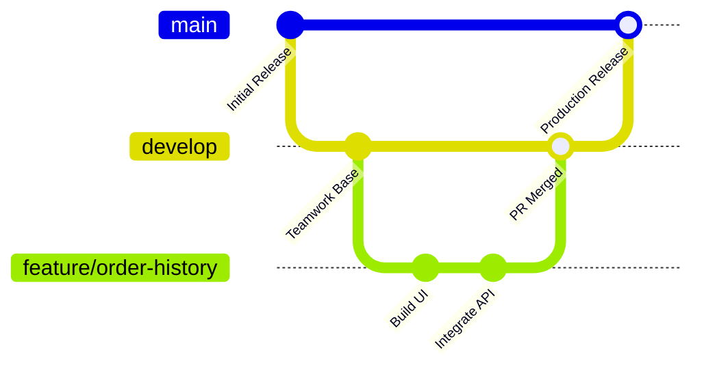

# 🍲 ភោជនីយដ្ឋាន ភូមិយើង (Phum Yeung Restaurant)
### Production-Ready All-in-One Food & Restaurant E-Commerce Platform

[](https://flutter.dev)
[](https://dart.dev)
[](https://riverpod.dev)
[](https://e-restaurant-uk4w.onrender.com/api)
[](https://mongodb.com)
[](https://e-restaurant-virid.vercel.app/admin/menu)
[](https://bakong.nbc.org.kh)

---

## 🌟 សេចក្តីសង្ខេបគម្រោង (Project Overview)

គម្រោង **ភោជនីយដ្ឋាន ភូមិយើង (Phum Yeung Restaurant)** គឺជាកម្មវិធី E-Commerce ផ្នែកម្ហូបអាហារពេញលេញ (Full-Stack) ដែលត្រូវបានបង្កើតឡើងដោយប្រើប្រាស់ **Flutter 3** និងដំណើរការបានយ៉ាងរលូនលើគ្រប់ Platform ទាំងអស់ (**Web Browser, Android, iOS និង Desktop**)។

កម្មវិធីនេះត្រូវបានភ្ជាប់ផ្ទាល់ជាមួយ **Cloud Backend API** នៅលើ Render និង Database **MongoDB Atlas** ព្រមទាំងមានប្រព័ន្ធទូទាត់ប្រាក់ពិតប្រាកដ **NBC Bakong KHQR** តាមស្តង់ដារជាតិកម្ពុជា។

### 🌐 ដំណភ្ជាប់សំខាន់ៗ (Live Links & Endpoints)
* 🐙 **GitHub Repository:** [https://github.com/Vatana007/App-ECommerce-Flutter.git](https://github.com/Vatana007/App-ECommerce-Flutter.git)
* ☁️ **Live Cloud Backend API:** `https://e-restaurant-uk4w.onrender.com/api`
* 🖥️ **Web Admin Portal (Vercel):** [https://e-restaurant-virid.vercel.app/admin/menu](https://e-restaurant-virid.vercel.app/admin/menu)
* 📡 **Health Check:** `https://e-restaurant-uk4w.onrender.com/api/health`

---

## ✨ មុខងារសំខាន់ៗ (Key Features)

### 🍱 ១. បញ្ជីមុខម្ហូប និងប្រភេទម្ហូប (Food Catalog & Categories)
- ទាញយកមុខម្ហូបពិតប្រាកដជាង ៥៩ មុខពី **MongoDB Atlas** តាមរយៈ API។
- មានតម្រៀបតាមប្រភេទម្ហូបដូចជា៖ `គ្រឿងសមុទ្រ`, `មាន់ស្រែ`, `ទា និង ក្ងាន`, `សាច់ជ្រូក`, `សាច់គោ`, `ភេសជ្ជៈ`...
- មុខងារស្វែងរកម្ហូបរហ័ស (Real-time Instant Search) និងច្រោះតាមកម្រិតហិរ (Mild, Hot, Extra)។
- បង្ហាញរូបភាពម្ហូបពិតៗដែលមានគុណភាពច្បាស់ (High Resolution Static Image Serving)។

### 🔐 ២. ប្រព័ន្ធគណនីអតិថិជន (Customer Auth & OTP Verification)
- **ចុះឈ្មោះ (Register):** បញ្ចូលឈ្មោះ លេខទូរស័ព្ទ អ៊ីមែល និងពាក្យសម្ងាត់។
- **ផ្ទៀងផ្ទាត់លេខកូដ OTP ៦ ខ្ទង់ (6-digit OTP Screen):** ផ្ទៀងផ្ទាត់លេខកូដសុវត្ថិភាព ដូចគ្នានឹងប្រព័ន្ធ Web។
- **ចូលប្រើ (Login):** ចូលតាមរយៈ Email ឬ Phone Number ជាមួយ JWT Token Authentication។

### 💳 ៣. ប្រព័ន្ធទូទាត់ប្រាក់ Bakong KHQR (NBC Standard KHQR)
- បង្កើត **EMVCo Compliant String (Tag 00 - 99)** ជាមួយ CRC16-CCITT Checksum ត្រឹមត្រូវ ១០០%។
- គណនា **MD5 Hash** សម្រាប់ផ្ទៀងផ្ទាត់ប្រតិបត្តិការផ្ទាល់ជាមួយ National Bank of Cambodia (NBC Bakong API)។
- ប៊ូតុងផ្ទៀងផ្ទាត់ ២ ជម្រើស៖ **ពិនិត្យដោយដៃ (Manual)** និង **ពិនិត្យស្វ័យប្រវត្តិ (Auto-Check: ON/OFF)**។

### 💵 ៤. ប្រព័ន្ធរូបិយប័ណ្ណទ្វេ (Dual Currency: USD $ & KHR ៛)
- បង្ហាញតម្លៃជា ២ ប្រភេទក្នុងពេលតែមួយ (ដុល្លារ `$ ` និង រៀល `៛`) តាមអត្រាប្តូរប្រាក់ស្តង់ដារ `1 USD = 4,100 KHR`។

### 👑 ៥. ផ្ទាំងគ្រប់គ្រងហាងរួមតែមួយ (All-in-One Admin Portal)
- មិនចាំបាច់ដំឡើង App ផ្សេងទេ Admin អាចគ្រប់គ្រងហាងផ្ទាល់ក្នុង Flutter App នេះតែម្តង៖
  - 📊 **ផ្ទាំងស្ថិតិ (Dashboard):** ចំណូលសរុប ចំនួន Order និងមុខម្ហូប។
  - 📋 **គ្រប់គ្រងការកុម្ម៉ង់ (Order Management):** ប្តូរស្ថានភាព `pending`, `preparing`, `delivering`, `delivered` ដោយចុចតែ ១ ប៊ូតុង។
  - 🍲 **គ្រប់គ្រងម្ហូប និងតម្លៃ (Catalog & Stock):** កែប្រែតម្លៃ បិទ/បើកស្តុក និងកំណត់មុខម្ហូបពិសេស។
  - ⚙️ **ការកំណត់ហាង (Settings):** បិទ/បើកហាងផ្ទាល់ កំណត់ថ្លៃដឹក និងអត្រាប្តូរប្រាក់។
  - **គណនី Admin Demo:** `admin@phumyeung.com` / `admin123` (មានប៊ូតុង Fill ស្វ័យប្រវត្តិ)។

### 🇰🇭 ៦. អក្សរខ្មែរស្រស់ស្អាត (Typography)
- ប្រើប្រាស់ពុម្ពអក្សរផ្លូវការ **Kantumruy Pro** ពី Google Fonts ដែលធានាការបង្ហាញតួអក្សរខ្មែរបានស្អាត និងត្រឹមត្រូវគ្រប់ទំហំអេក្រង់។

---

## 🏗️ ស្ថាបត្យកម្មប្រព័ន្ធ (Project Architecture)

```text
Project-Final/
├── flutter_app/                    # កម្មវិធី Flutter Frontend (Mobile + Web)
│   ├── lib/
│   │   ├── main.dart               # App Entrypoint & ProviderScope
│   │   ├── app/
│   │   │   ├── app.dart            # MaterialApp.router, AppTheme & Localization
│   │   │   └── router/             # GoRouter Configuration គ្រប់ Route ទាំងអស់
│   │   ├── core/
│   │   │   ├── config/             # AppConfig (ចង្អុលទៅ Cloud Backend ស្វ័យប្រវត្តិ)
│   │   │   ├── network/            # DioClient ជាមួយ AuthInterceptor & LogInterceptor
│   │   │   └── theme/              # Kantumruy Pro Font & App Colors
│   │   ├── features/
│   │   │   ├── auth/               # Customer Login, Register, OTP Verification
│   │   │   ├── catalog/            # Categories, Dishes Grid, Live Search, Riverpod
│   │   │   ├── cart/               # Cart State, Quantity Update, Promo Code Engine
│   │   │   ├── checkout/           # Delivery address, payment options
│   │   │   ├── orders/             # Order tracking timeline & history
│   │   │   ├── product_detail/     # Dish details, spice levels, add-to-cart
│   │   │   ├── profile/            # Customer profile & Admin Portal shortcut
│   │   │   ├── admin/              # Live Admin Management Portal
│   │   │   └── scan/               # QR Code scanner
│   │   └── shared/
│   │       ├── models/money.dart   # Dual Currency Helper ($ & ៛)
│   │       └── widgets/            # ProductCard, BottomNavigationBar...
│   └── pubspec.yaml
│
├── CONTRIBUTING.md                 # ការណែនាំលម្អិតសម្រាប់ការធ្វើការជាក្រុម
└── README.md                       # ឯកសារណែនាំទូទៅនៃគម្រោង
```

---

## ⚡ របៀបដំណើរការ (Quick Start Guide)

> [!TIP]
> ដោយសារកូដត្រូវបានភ្ជាប់ជាមួយ Cloud Backend នៅលើ Render រួចជាស្រេច អ្នក**មិនចាំបាច់បើក Local Backend ទេ**។ គ្រាន់តែ Clone រួច Run Flutter គឺដំណើរការភ្លាមៗ!

### ១. Clone គម្រោង
```bash
git clone https://github.com/Vatana007/App-ECommerce-Flutter.git
cd App-ECommerce-Flutter
git checkout develop
```

### ២. ដំណើរការ Flutter App
ចូលទៅកាន់ folder `flutter_app` រួចដំឡើង dependencies៖
```bash
cd flutter_app
flutter pub get
```

#### ជម្រើស A: ដំណើរការលើ Web Browser (Google Chrome)
```bash
flutter run -d chrome
```

#### ជម្រើស B: ដំណើរការលើ Android Emulator ឬទូរស័ព្ទពិត
```bash
flutter run -d android
```

#### ជម្រើស C: ដំណើរការលើ Windows Desktop
```bash
flutter run -d windows
```

---

## 🤝 យុទ្ធសាស្ត្រធ្វើការជាក្រុម (Teamwork & Git Strategy)

យើងប្រើប្រាស់ទម្រង់ **Git Flow Simplified** ដើម្បីធានាភាពស្អាតនៃ Branch និងជៀសវាង Merge Conflict៖



### 🌿 ស្តង់ដារ Branch
* **`main` (Production):** កូដផ្លូវការដែលបានតេស្តចប់សព្វគ្រប់ គ្មាន Error។
* **`develop` (Integration):** មែកធាងមេសម្រាប់ក្រុមការងារទាំងអស់ទាញយក និងបញ្ចូលកូដរួម។
* **`feature/<name>`:** មែកធាងសម្រាប់សរសេរមុខងារថ្មី (ឧ. `feature/user-profile`)។
* **`fix/<name>`:** មែកធាងសម្រាប់ជួសជុលបញ្ហា (ឧ. `fix/cart-calculation`)។

> 📖 សូមអានបន្ថែមក្នុង [CONTRIBUTING.md](CONTRIBUTING.md) សម្រាប់ច្បាប់នៃការធ្វើការជាក្រុម។

---

## 📡 បញ្ជី API Endpoints (Cloud Backend API)

| Method | Endpoint | មុខងារ |
|---|---|---|
| `GET` | `/api/health` | ពិនិត្យស្ថានភាព Server & MongoDB Atlas |
| `GET` | `/api/categories` | បញ្ជីប្រភេទម្ហូបទាំងអស់ |
| `GET` | `/api/dishes` | បញ្ជីមុខម្ហូបទាំងអស់ទាំង ៥៩ មុខ |
| `GET` | `/api/dishes/:id` | ព័ត៌មានលម្អិតនៃមុខម្ហូបមួយ |
| `POST` | `/api/v1/auth/customer/login` | ចូលប្រើប្រាស់សម្រាប់អតិថិជន |
| `POST` | `/api/v1/auth/customer/register` | ចុះឈ្មោះគណនីអតិថិជនថ្មី |
| `POST` | `/api/v1/orders` | បង្កើត Order និងទទួលយក KHQR សម្រាប់ទូទាត់ |
| `GET` | `/api/v1/orders/:id` | តាមដានស្ថានភាព Order |
| `GET` | `/images/foods/:filename` | ទាញយករូបភាពម្ហូប |

---

## 🎁 កូដប្រូម៉ូសិនសាកល្បង (Test Promo Codes)

| កូដ (Promo Code) | ការបញ្ចុះតម្លៃ | លក្ខខណ្ឌ |
|---|---|---|
| `PHUM10` | បញ្ចុះតម្លៃ **10%** | សម្រាប់ការកុម្ម៉ង់ដំបូង |
| `KHMER20` | បញ្ចុះតម្លៃ **20%** | សម្រាប់ការកុម្ម៉ង់ចាប់ពី $20 ឡើងទៅ |
| `FREESHIP` | មិនគិតថ្លៃដឹក **$1.50** | ដឹកជញ្ជូនឥតគិតថ្លៃ |

---

## 👥 សមាជិកក្រុមការងារ (Development Team)

គម្រោងនេះត្រូវបានរួមគ្នាស្រាវជ្រាវ និងអភិវឌ្ឍដោយក្រុមនិស្សិតឆ្នាំទី ៤ (Year 4 Engineering Team)៖

| ល.រ (No.) | ឈ្មោះសមាជិក (Team Member) | តួនាទី / ទំនួលខុសត្រូវ (Role & Responsibilities) |
|:---:|---|---|
| **១** | **HIM Lihour** | Full-Stack Integration & Cloud Backend Architecture |
| **២** | **VUTH Vatana** | Flutter Mobile/Web Core & State Management (Riverpod) |
| **៣** | **LORN Sovannarorth** | UI/UX Design System & Product Catalog Engine |
| **៤** | **REAM Rithy** | Payment Integration (NBC Bakong KHQR) & Order Engine |

---

## 📄 អាជ្ញាប័ណ្ណ (License)

គម្រោងនេះត្រូវបានបង្កើតឡើងសម្រាប់គោលបំណងសិក្សា និងស្រាវជ្រាវ (Year 4 Final Project)។ រក្សាសិទ្ធិគ្រប់យ៉ាងដោយក្រុមការងារ **ភោជនីយដ្ឋាន ភូមិយើង**។
